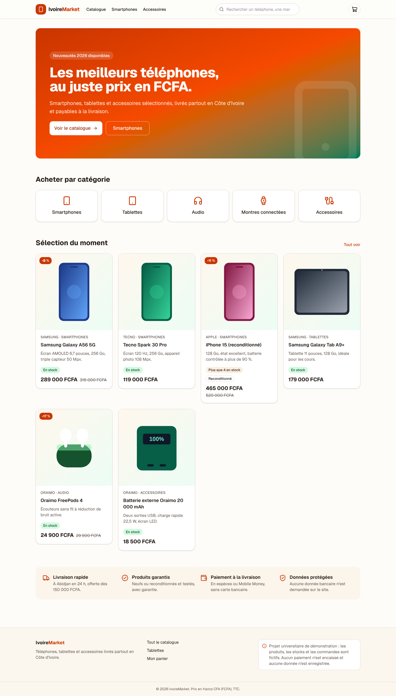

# IvoireMarket

Site e-commerce de démonstration pour la vente de téléphones, tablettes et accessoires en Côte d'Ivoire, avec des prix en francs CFA. Projet universitaire.

> **Commande simulée.** Les produits et les stocks sont fictifs. Le formulaire de commande est vérifié par le serveur, mais aucune commande n'est enregistrée, aucun paiement n'est effectué et aucune donnée bancaire n'est demandée.



## Fonctionnalités

| Fonctionnalité | Où |
| --- | --- |
| Page d'accueil (catégories, sélection, engagements) | `src/app/page.tsx` |
| Catalogue avec recherche (insensible aux accents), filtres et tri dans l'URL | `src/app/produits/page.tsx`, `src/features/products/` |
| Fiche produit (caractéristiques, stock, garantie, JSON-LD schema.org) | `src/app/produits/[slug]/page.tsx` |
| Panier : ajout, quantités, suppression, totaux en FCFA, livraison offerte dès 150 000 FCFA | `src/features/cart/` |
| Panier conservé après actualisation (localStorage, validé avec Zod, synchronisé entre onglets) | `src/features/cart/cart-store.ts` |
| Formulaire de commande (React Hook Form + Zod, numéros ivoiriens, champ anti-robot) | `src/features/checkout/` |
| Validation répétée côté serveur et prix recalculés depuis le catalogue (Server Action) | `src/features/checkout/create-simulated-order.ts` |
| Page de confirmation avec référence de commande | `src/app/commande/confirmation/` |
| États vides, page 404, page d'erreur, interface responsive | `src/app/not-found.tsx`, `src/app/error.tsx` |

## Stack technique

| Outil | Version | Rôle |
| --- | --- | --- |
| Next.js (App Router, Cache Components) | 16.4.0 | Framework |
| React | 19.3.0 | Interface |
| TypeScript (`strict: true`) | 5.9.3 | Langage |
| Tailwind CSS | 4.3.3 | Styles |
| shadcn/ui (Radix UI) | style new-york | Composants (`src/components/ui`) |
| Lucide React | 1.55.0 | Icônes |
| Zod | 4.6.6 | Validation |
| React Hook Form | 7.90.0 | Formulaire de commande |
| Vitest | 5.0.4 | Tests unitaires |
| Playwright | 1.56.1 | Tests navigateur |
| ESLint | 9.39.5 (config Next.js) | Qualité du code |
| Docker | image `node:24-alpine` | Conteneurisation |

TypeScript 5.9 et ESLint 9 sont les versions installées par `create-next-app` 16.4 : les versions majeures plus récentes (TypeScript 7, ESLint 10) ne sont pas encore prises en charge par la configuration officielle de Next.js.

Les composants shadcn/ui ont été ajoutés dans `src/components/ui` en suivant le style « new-york » (`components.json` est présent). D'autres composants peuvent être ajoutés avec `npx shadcn@latest add <composant>`.

## Architecture

```
src/
  app/                      Routes (Server Components par défaut)
  components/ui/            Composants shadcn/ui
  components/layout/        En-tête et pied de page
  features/products/        Catalogue : données, recherche, filtres, cartes produits
  features/cart/            Panier : calculs centralisés, stockage navigateur, composants
  features/checkout/        Commande : schéma Zod, action serveur, formulaire, confirmation
  lib/                      Utilitaires (format FCFA, classes CSS)
  types/                    Types Product, CartItem, CartLine, SimulatedOrder…
  data/                     Produits de démonstration
public/products/            Illustrations SVG des produits (scripts/generate-product-images.mjs)
tests/unit/                 Tests Vitest
tests/e2e/                  Tests Playwright
```

**Server ou Client Components.** Les pages, le catalogue, les filtres (formulaire GET) et les fiches produits sont des Server Components : ils n'envoient pas de JavaScript au navigateur. Seuls les éléments qui ont besoin du navigateur sont des Client Components : le bouton d'ajout au panier, l'icône du panier, la page panier, le formulaire de commande et la confirmation (ils lisent `localStorage` ou réagissent aux clics).

**Pourquoi pas de base de données.** Pour une première version dans un délai universitaire, une base de données ajouterait un service à installer, sécuriser et payer sur EC2, sans être nécessaire à la démonstration du parcours d'achat. Le panier vit dans le navigateur ; la commande est validée par le serveur puis affichée, sans être enregistrée. Pour une vraie boutique, il faudrait ajouter une base (par exemple PostgreSQL géré), l'authentification, la gestion des stocks et un prestataire de paiement (CinetPay, Wave, Orange Money…) appelé côté serveur, sans jamais stocker de données bancaires.

**Sécurité.** Les prix ne viennent jamais du navigateur : le serveur recalcule tout à partir du catalogue. Les données du formulaire sont revalidées côté serveur avec le même schéma Zod. Le contenu de `localStorage` est validé avant usage. Des en-têtes de sécurité sont ajoutés (`next.config.ts`) et le conteneur tourne avec un utilisateur non privilégié.

## Démarrer en local

Prérequis : Node.js 22 ou plus récent, npm.

```bash
npm ci
npm run dev          # http://localhost:3000
```

## Vérifications

```bash
npm run lint         # ESLint
npm run typecheck    # TypeScript strict
npm run test         # 39 tests unitaires Vitest
npx playwright install chromium   # une seule fois
npm run test:e2e     # 18 tests Playwright (ordinateur + mobile) sur la version de production
npm run build        # compilation de production
```

Les tests Playwright couvrent le parcours complet (recherche, fiche produit, ajout au panier, modification des quantités, persistance après actualisation, erreurs de validation, choix de la zone de livraison, commande et confirmation) et un audit d'accessibilité automatique WCAG 2.2 AA avec axe-core sur les pages principales. Pour les rejouer contre un conteneur ou le serveur EC2 :

```bash
BASE_URL=http://<adresse> npx playwright test
```

Le workflow `.github/workflows/ci.yml` lance toutes ces vérifications à chaque push sur GitHub.

## Docker

```bash
docker build -t ivoiremarket:v1 .
docker run -d --name ivoiremarket -p 8080:3000 ivoiremarket:v1
# http://localhost:8080
```

Le `Dockerfile` est commenté ligne par ligne. Publication sur Docker Hub et déploiement sur AWS EC2 : voir [docs/DEPLOIEMENT.md](docs/DEPLOIEMENT.md).
